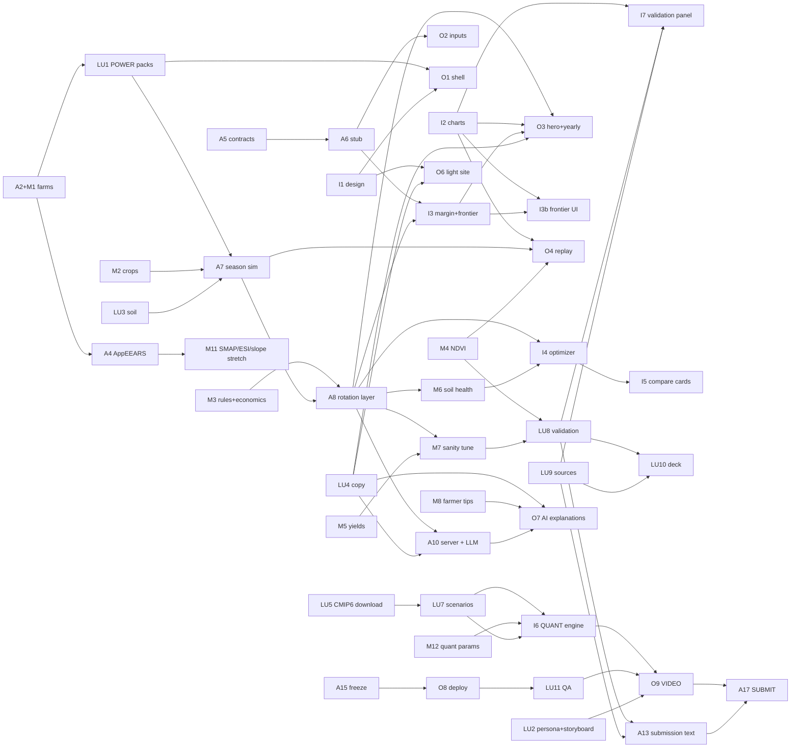

# 01 · The plan: who does what, together, and when

## The team
| Person | Main focus | Also | Task IDs | File |
|---|---|---|---|---|
| **Albert** | Lead + **Rust** engine core (season/rotation), WASM build, **Axum server + LLM endpoint** | AppEEARS requests, submission | `A1…` | [ALBERT.md](ALBERT.md) |
| **Moldo** | Agronomy: the practical side (crops, rotations, economics, equipment, "does this make sense to a farmer?") | NDVI + yield data, soil health, **quant price/yield parameters** | `M1…` | [MOLDO.md](MOLDO.md) |
| **Luca** | Data pipeline (weather, soil, climate projections) + validation numbers | Story: persona, copy, **LLM prompts**, deck | `LU1…` | [LUCA.md](LUCA.md) |
| **Ionut** | **Rust** stress test, optimizer and **quant engine** (Monte Carlo futures + risk metrics) + charts + design system | Validation panel, video graphics | `I1…` | [IONUT.md](IONUT.md) |
| **Octa** | Frontend lead: full app (WASM in the browser), **light site** (Astro), AI-explanation UI, replay, live click, deploy | **The video** | `O1…` | [OCTA.md](OCTA.md) |

Nobody does "one thing". Everyone works in **2–3 workstreams**, always paired with someone:

| Workstream | Owner (final say) | Works with | What it produces |
|---|---|---|---|
| **Engine** (Rust: simulation, stress, quant) | Albert | Moldo (agronomy + quant params), Ionut (stress/optimizer/quant) | `crates/` |
| **AI explanations** (LLM via our API) | Albert (server) | Luca (prompts), Octa (UI), Moldo (reviews answers) | `/api/explain`, `prompts/` |
| **Data** (NASA pipelines) | Luca | Moldo (NDVI, yields, farm presets), Albert (AppEEARS) | `pipeline/`, `web/data/` |
| **App + light site** (frontend) | Octa | Ionut (charts, design system, cards, frontier, panels) | `web/`, `site/` |
| **Story** (pitch, deck, video) | Luca (deck) · Octa (video) | Ionut (design), Moldo (farmer realism), Albert (pitch) | deck, video, copy |
| **Integration + submission** | Albert | Octa (backup merger) | `main`, checkpoints, submission |

Albert already made the **GitHub repo** and the **Google Drive**. Use GitHub for code and docs, Drive for everything else
(see "Google Drive" below).

## Clock
All times are **T+hours from kickoff**. Write the real clock times at kickoff:

| T0 | CP0 T+1 | CP1 T+3 | CP2 T+11 | CP3 T+21.5 | CP4 T+25 FREEZE | CP5 T+31 | CP6 submit (deadline −2 h) |
|---|---|---|---|---|---|---|---|
| ____ | ____ | ____ | ____ | ____ | ____ | ____ | ____ |

If the real deadline is shorter, shrink every phase proportionally and drop stretch tasks first.

## Sleep shifts (at least 2 people awake at all times)
| Shift | Who sleeps | When | Awake and merging |
|---|---|---|---|
| 1 | **Luca, Octa** | ≈T+11.5 → T+15.5 | Albert (merges), Moldo, Ionut |
| 2 | **Albert, Moldo, Ionut** | ≈T+15.5 → T+19.5 | Octa (merges), Luca |
| — | Naps after CP5 if the submission is ready | | |

## Sync rhythm (short, standing, timed)
| Sync | Who | When | 10-minute agenda |
|---|---|---|---|
| **Checkpoint stand-up** | everyone, run by Albert | CP0–CP5 | read the checklist; done / fallback / blocked |
| **Engine sync** | Albert + Moldo (+ Ionut) | T+4.5, T+8.5, T+13.5 | parameters, rules, sanity numbers |
| **Data sync** | Luca + Moldo + Albert | T+2.5, T+10, T+17.5 | which layers are in, what's missing |
| **UI sync** | Octa + Ionut | T+3, T+7.5, T+13.5, T+20.5 | layout, components, who touches which file |
| **Story sync** | Luca + Octa + Ionut + Moldo | T+4, T+21.5, T+26 | persona, storyboard, deck, video |

Rule: when you finish something that unblocks someone, post in the team chat
**"`LU1 done → A7, O1 unblocked` + file path"**. Blocked > 30 min → tell Albert.

---

## Everyone's timeline at a glance
```
T+   0     2     4     6     8    10    12    14    16    18    20    22    24    26    28    30
Albert  |-A1 Rust+WASM-|A4-A6|---A7 season.rs---|-A8 rotation-|A9|-A10 server+LLM-|A11|zzzz sleep zzzz|A13 text|A14|A15|--A16 rehearse--|
Moldo   --M1--|---M2 crops---|-M3 rules/€/equip-|--M4 NDVI--|-M5 yields-|-M6 soil-|-M7 tune-|zzzz|-M12 quant params-|-M8-|-M9 Q&A-|--M10--|
Luca    |-LU1 POWER-|LU2|--LU3 soil--|---LU4 copy+LLM prompts---|LU5↓|LU6|zzzz sleep zzzz|-LU7-|-LU8 valid-|LU9|--LU10 deck--|LU11|
Ionut   ---I1 design---|--I2 charts--|--I3 stress.rs--|I3b|---I4 optimize.rs---|-I5 cards-|zzzz|---I6 QUANT quant.rs---|I7|-I9 video gfx-|
Octa    |----O1 shell+WASM----|---O2 inputs+budget---|---O3 hero+yearly---|zzzz sleep zzzz|--O4 replay--|-O5 live-|-O6 SITE-|-O7 AI UI-|O8|--O9 VIDEO--|
```

---

## Checkpoints (gates)
A checkpoint **passes** when every item is done, or Albert explicitly accepts the fallback written next to it.

### CP0 · T+1 · "Kickoff done"
- [ ] A1 repo skeleton + stack + Pages; Drive folders created
- [ ] A2/M1 demo farms chosen (coordinates + usual rotation)
- [ ] Everyone has cloned the repo, opened the empty page, and read 00_IDEA.md + their own file

### CP1 · T+3 · "Foundations"
- [ ] A4 AppEEARS requests **submitted** (queue takes hours)
- [ ] A5 [02_CONTRACTS.md](02_CONTRACTS.md) signed off
- [ ] A1 Rust → WASM "hello" runs in everyone's browser · A6 Rust stub built to `web/pkg` (Ionut and Octa build on it)
- [ ] LU1 first real pack (Iowa weather) merged · *fallback: the mock pack*
- [ ] I1 wireframe + design tokens; LU2 persona started
- [ ] O1 app shell shows the map with farm markers (work in progress is fine)

### CP2 · T+11 · "First full loop": Albert demos it live
- [ ] A7 season simulator + A8 rotation layer merged; smoke test prints yields for every farm
- [ ] M2 crop library + M3 rotation rules and farm economics merged
- [ ] LU3 soil in all packs · M4 NDVI in ≥ 1 pack
- [ ] I3 margin + frontier (Rust) running on the **real** engine in WASM · O2 inputs · O3 hero margin + yearly chart · *plan B: same calls via the server*
- [ ] LU4 copy · LU5 CMIP6 downloads running · LU6 deck skeleton
- [ ] A9 cut list written · *fallback if the engine is late: demo on the stub; Ionut helps Albert*

### CP3 · T+21.5 · "All features in"
- [ ] I4 optimizer + I5 compare cards · I3b frontier heatmap
- [ ] O4 drought replay · O5 live click anywhere
- [ ] M6 soil-health metrics · M7 sanity-tuned yields · M5 county yields
- [ ] LU7 2050 scenarios in packs · *fallback: illustrative markers, labelled*
- [ ] LU8 validation numbers (`summary.json`)
- [ ] A10 server deployed: `/api/simulate`, `/api/explain` streams LLM explanations (template fallback works)

### CP4 · T+25 · FEATURE FREEZE
- [ ] I6 **quant engine**: fan chart 2026–2050, VaR/CVaR, ruin probability, "safe until ~20XX" · M12 quant params
- [ ] O6 light site deployed · O7 AI explanations + plan · I7 validation + data panel · LU9 data-source list
- [ ] M9 Q&A draft · A14 SCIENCE.md
- [ ] A15 `main` tagged `v1.0-freeze` → O8 deployed; smoke test passes
- [ ] **After this: bug fixes only.** New ideas go on the deck's "Future work" slide.

### CP5 · T+31 · "Story locked"
- [ ] O9 video final, uploaded · LU10 deck final · A13 submission text final · M9 Q&A final
- [ ] A16 two full rehearsals (Albert presents, Moldo answers farmer/agronomy questions)

### CP6 · deadline − 2 h · "Submitted"
- [ ] A17 form submitted; every link opened in incognito **on a phone**

---

## Dependency map


### Critical paths (Albert checks these at every checkpoint)
1. **Engine (Rust):** `A1 Rust+WASM skeleton → LU1 + M2 + LU3 → A7 → A8 → I3 → O3 → CP2`. Albert codes it; Moldo feeds parameters fast; Ionut takes over A8 if A7 runs late; if WASM fights back, plan B = same API on the server.
2. **Validation:** `M4 + M5 → M7 → LU8 → I7 / LU10 / A13`. This earns the *Validity* score.
3. **Projections:** `LU5 (downloads during Luca's sleep) → LU7 → I6`.
4. **Video:** `A15 freeze → O8 → LU11 → O9 → A17`. Octa records **only from the frozen build**.
5. **AppEEARS:** `A4 → (queue) → A10`. Has a fallback, but A4 must be submitted before CP1.

## Who owns which files (one owner each; others open a PR and tag the owner)
| Person | Files |
|---|---|
| Albert | `Cargo.toml` · `crates/fieldshift-core/src/{lib,season,rotation,soil,explain}.rs` · `crates/fieldshift-wasm/` · `crates/fieldshift-server/` · Rust tests · `docs/team/*`, `docs/CHALLENGE.md`, `docs/SUBMISSION.md`, `docs/SCIENCE.md`, `README.md` |
| Moldo | `crates/fieldshift-core/data/crops.json`, `src/soil_health.rs` · `data/equipment.json`, `data/quant_params.json` · `pipeline/presets.json`, `pipeline/ndvi/`, `pipeline/yields/`, `pipeline/quant/`, `pipeline/appeears/` · `web/data/validation/<farm>.json` · `docs/QA.md` |
| Luca | `pipeline/power/`, `pipeline/soil/`, `pipeline/cmip6/`, `pipeline/build_packs.py` · `web/data/farms/*`, `web/data/layers/*` (assembly), `web/data/mock/*` · `web/data/validation/summary.json` · `prompts/*` (LLM) · `docs/DATA_SOURCES.md`, `docs/STORY.md` |
| Ionut | `crates/fieldshift-core/src/{stress,optimize,quant}.rs` · `web/css/*` (shared with the site) · `web/src/charts.ts` · `web/src/ui/{compare,frontier,marginyear,science}.ts` · `assets/brand/` |
| Octa | `web/` shell (`index.html`, `src/main.ts`, `src/ui/{inputs,hero,yearly,replay,explain,report}.ts`, `src/data/*`) · `site/` (Astro) · deployment (app + site) · video |

- Branch per task (`lu1-power`, `a7-season`, `o4-replay`…), small PRs. Albert merges (Octa while Albert sleeps). **`main` must always load.**
- Exception: during a sleep shift, the merger may make an urgent fix in a sleeping person's file and tells them on wake-up.

## Google Drive (Albert's): suggested folders
`01 Research` (papers, crop sources, price sources: Moldo, Luca) · `02 Design` (wireframes, persona, brand: Ionut, Luca) ·
`03 Deck` (Luca) · `04 Video` (raw captures, music, edits: Octa) · `05 Screenshots` (everyone) · `06 Submission` (Albert).
